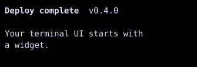

# Text

`Text` displays plain text or a sequence of styled spans.



## [Example](index.md#run-an-example)

```go
--8<-- "docs/widget-examples/display/examples.go:text"
```

## Behavior

- `Content` supplies plain text, and nonempty `Spans` take precedence.
- `WrapNone` is the default and clips lines at the available width.
- `WrapSoft` wraps at word boundaries and breaks words that exceed the available width.
- `WrapHard` breaks lines at the available width.
- `TextAlignLeft`, `TextAlignCenter`, and `TextAlignRight` position each line within the available width.
- `Style` sets dimensions, colors, padding, borders, and text decoration.
- Span styles can override the base text style.
- A span with `Style.Link` set is a [terminal hyperlink](../hyperlinks.md).

## Nerd Font symbols

Nerd Fonts are **off by default**. Use
`NerdFontSymbol(symbol, fallback string) string` to choose an icon or a fallback.
It returns a string, so it also works in button labels, spans, and other string
fields:

```go
label := terma.Text{
    Content: terma.NerdFontSymbol("\uf07b", "[dir]") + " Projects",
}
```

Set the preference once for the whole app, during setup or in an event handler:

```go
terma.SetNerdFontsEnabled(true)  // Opt in when the user has a suitable font.
terma.SetNerdFontsEnabled(false) // Use fallbacks everywhere (the default).
```

Read the current preference with `terma.NerdFontsEnabled()`. Applications can
wire the setter to a configuration field, command-line flag, or settings UI.
It affects calls to `NerdFontSymbol`, not glyphs written directly into strings.

When enabled, the helper returns `symbol`; otherwise it returns `fallback`.
Both are returned unchanged. They may include spaces or multiple
characters; an empty fallback hides an optional icon. The helper does not pad
the strings to equal widths.

Terma does not auto-detect Nerd Fonts. There is no portable terminal query for
Nerd Font availability, and terminal names or fonts installed on the app's host
do not establish which glyphs the user's terminal can render (especially over
SSH). Some terminals offer [glyph queries](https://rioterm.com/docs/features/glyph-protocol),
but these are not supported across terminals. Expose a user preference and
default to the fallback when support is unknown.

The choice is made on each call; a string resolved during setup stays unchanged.
For live switching, call the helper in `Build()`. It subscribes the widget to
the preference, so changing the setting updates the text and its layout:

```go
func (a *App) Build(ctx terma.BuildContext) terma.Widget {
    return terma.Text{
        Content: terma.NerdFontSymbol("\uf07b", "[dir]") + " Projects",
    }
}
```

Do not call `SetNerdFontsEnabled` inside `Build()`.

## Related

- For changing values, [PresentedText](presentedtext.md) provides reactive text helpers.
